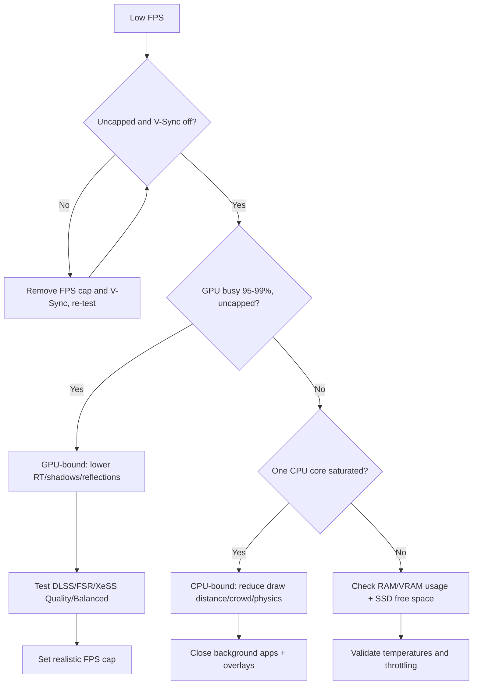
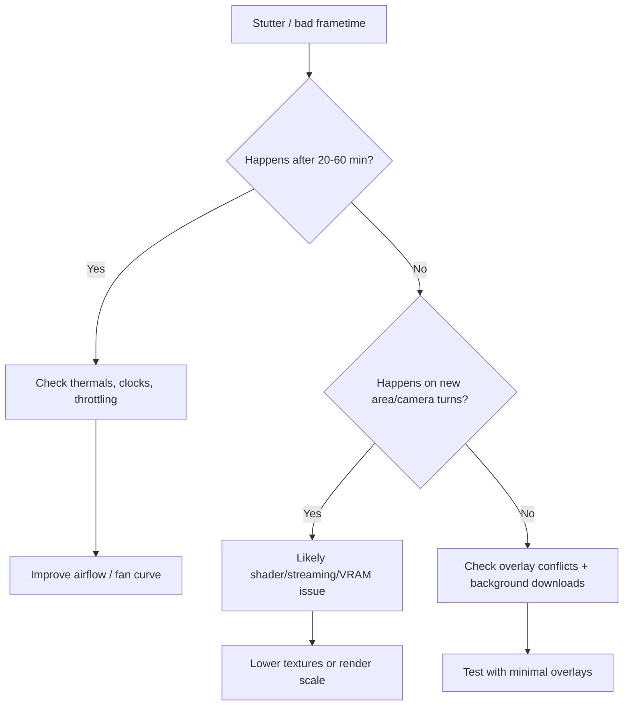
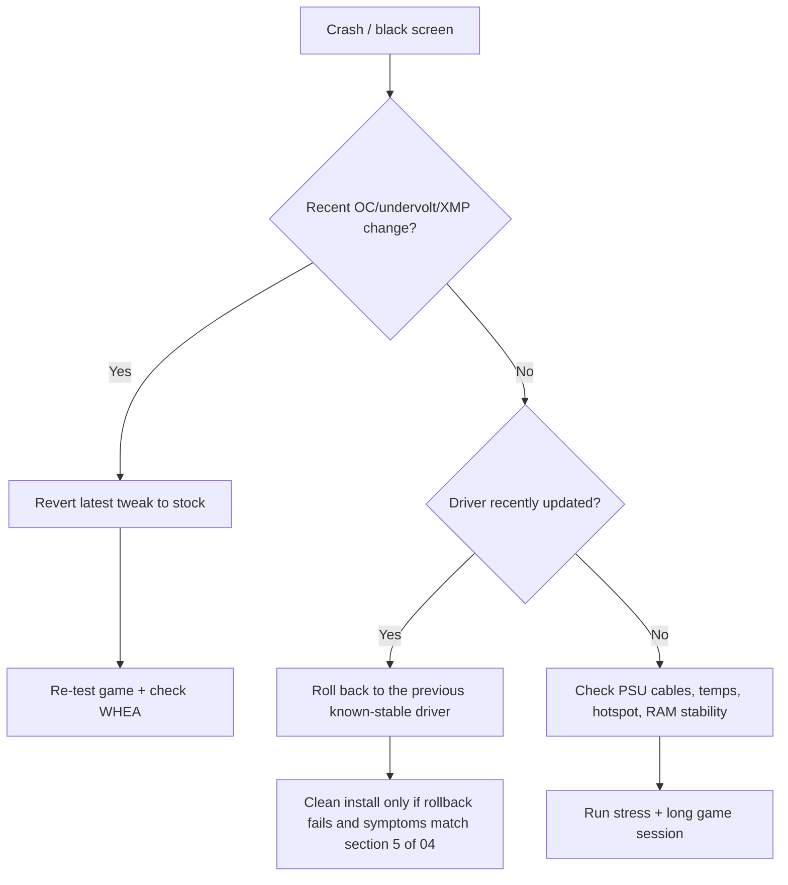
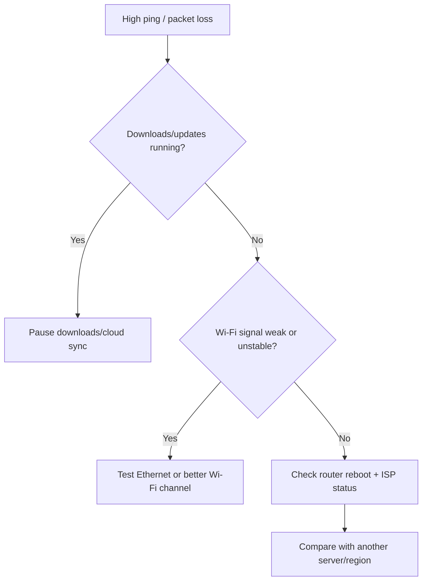
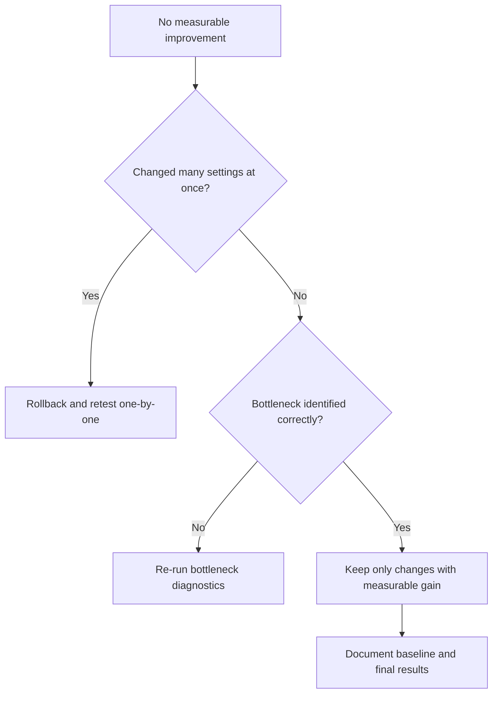

# 15. Troubleshooting Decision Trees

> Fast path: find symptom → follow decision tree → test one fix at a time.

## How to use

- Start from the tree matching your issue.
- Apply one action.
- Re-test the same game scene.
- If no change, move to next branch.

---

## 1) Low FPS tree

> [!IMPORTANT]
> Measure the first branch with the frame cap removed and V-Sync off. A capped or V-Sync-limited GPU can show low usage even when it is still the limiting component. Prefer GPU busy time from PresentMon or CapFrameX over a Task Manager percentage.

Quick actions table:

| Signal | First fix |
|---|---|
| GPU busy 95-99% with no cap, low FPS | Reduce GPU-heavy settings first |
| GPU not saturated, one CPU core maxed | Reduce CPU-heavy settings + background load |
| Normal average FPS, bad 1% low | Check RAM/VRAM/SSD + shader/loading stutter |

---

## 2) Stutter / bad frametime tree

Quick actions table:

| Symptom pattern | Likely cause |
|---|---|
| Gets worse over time | Thermal saturation |
| Spikes on new zones | Shader compile / storage streaming |
| Spikes with Discord/recording | Overlay/capture overhead |

---

## 3) Crash / black screen tree

Quick actions table:

| If this happened after… | Do this first |
|---|---|
| Curve Optimizer / PBO tweak | Revert and test stock |
| GPU undervolt | Relax curve or return default |
| Driver update | Roll back first; clean install only if rollback fails |

---

## 4) High ping / packet loss tree

Quick actions table:

| Network issue | First check |
|---|---|
| Sudden ping spikes | Background downloads/updates |
| Random packet loss | Wi-Fi quality / cable / router |
| Region-specific lag | Server-side routing/load |

---

> [!NOTE]
> Measure ping against the game server region or address you actually play on. Baseline connectivity checks such as `1.1.1.1` do not replace real-game server latency measurement.

---

## 5) “No change after optimization” tree

---

## Safety guardrails

- Do not disable Defender/Firewall/Update for FPS.
- Do not apply unknown scripts.
- Do not stack multiple changes without testing.

Next step: [16 Benchmark templates](16-benchmark-templates.md).
