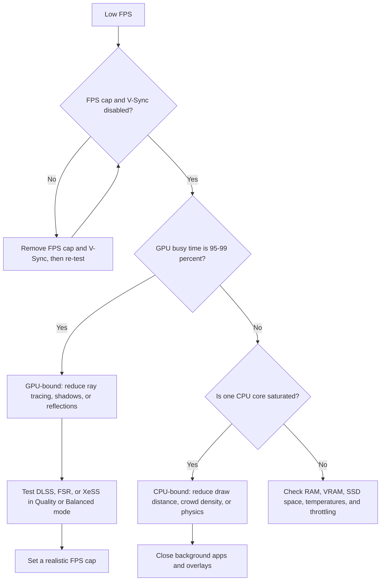
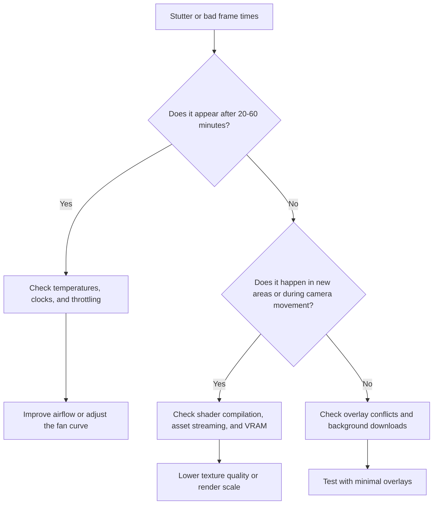
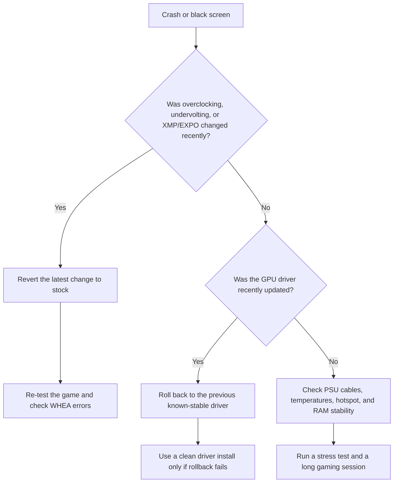
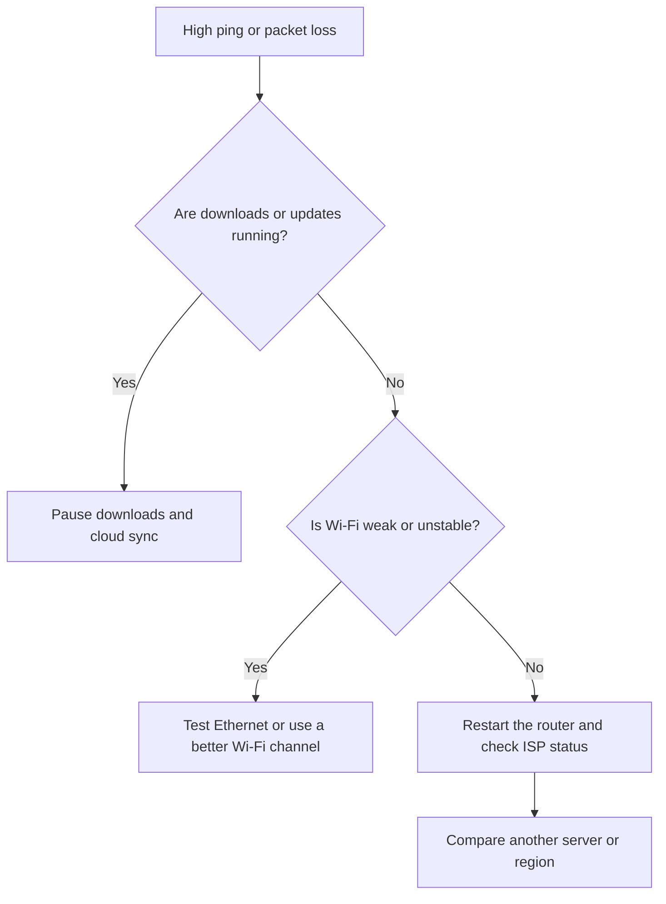
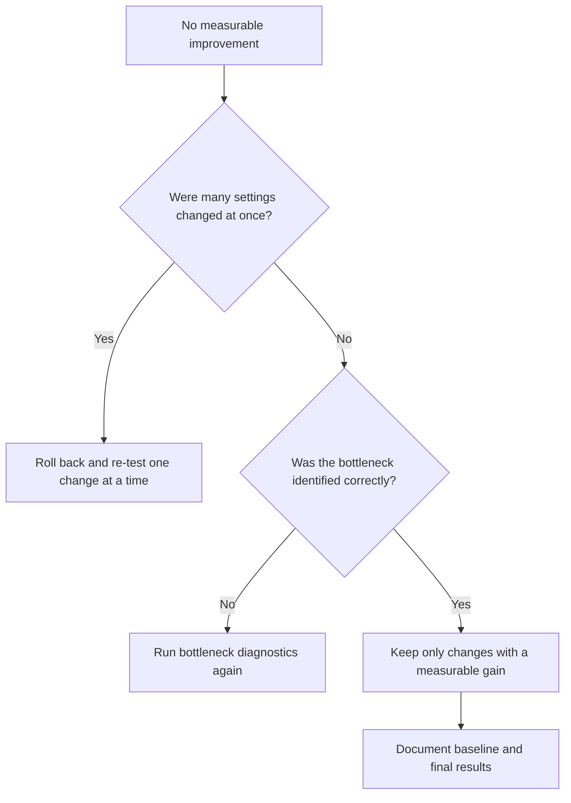

Find the symptom, follow one decision tree, and test one fix at a time.

## How to use

1. Choose the tree that matches your issue.
2. Apply one action.
3. Re-test the same game scene.
4. If nothing changes, move to the next branch.
5. Keep a change only when the result is repeatable.

---

## Low FPS

> **Important:** Measure the first branch with the FPS cap removed and V-Sync disabled. A capped or V-Sync-limited GPU can show low usage even when it is still the limiting component. Prefer GPU busy time from PresentMon or CapFrameX over Task Manager percentages.

| Signal | First fix |
| --- | --- |
| GPU busy time is 95–99% without a cap, but FPS is low | Reduce GPU-heavy settings |
| GPU is not saturated and one CPU core is maxed | Reduce CPU-heavy settings and background load |
| Average FPS is normal, but 1% lows are poor | Check RAM, VRAM, SSD, shaders, and loading stutter |

---

## Stutter and bad frame times

| Pattern | Likely cause |
| --- | --- |
| Gets worse over time | Thermal saturation |
| Spikes in new zones | Shader compilation or storage streaming |
| Spikes with Discord, recording, or browser video | Overlay or capture overhead |

---

## Crashes and black screens

| If this started after… | Do this first |
| --- | --- |
| Curve Optimizer or PBO tuning | Revert to stock and re-test |
| GPU undervolting | Relax the curve or return to defaults |
| A driver update | Roll back first; clean-install only if rollback fails |

---

## High ping and packet loss

| Network issue | First check |
| --- | --- |
| Sudden ping spikes | Background downloads or updates |
| Random packet loss | Wi-Fi quality, Ethernet cable, or router |
| Lag only on one server or region | Server-side routing or load |

> **Note:** Measure ping against the game server region or address you actually play on. A baseline check against `1.1.1.1` does not replace real-game server latency measurement.

---

## No measurable improvement

---

## Safety guardrails

- Do not disable Defender, Firewall, or Windows Update for FPS.
- Do not run unknown scripts.
- Do not stack multiple changes without testing.
- Do not treat a subjective feeling as proof of lower latency.

---

## Next step

[Benchmark Templates](16-benchmark-templates.html)
